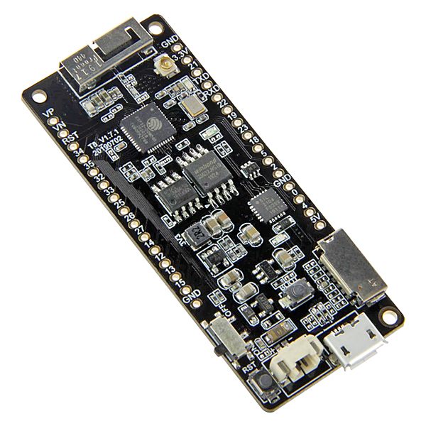
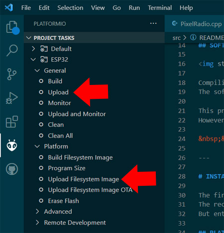
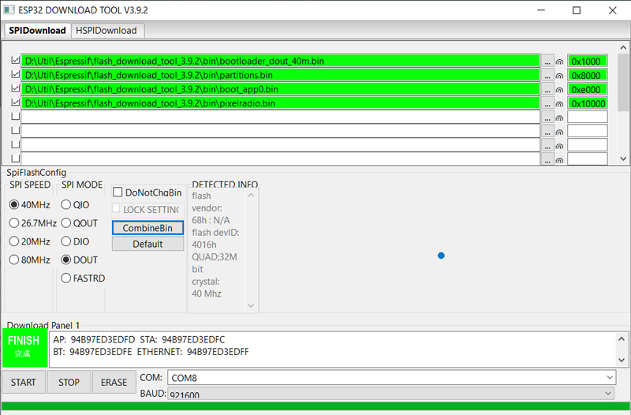

# 

# PROJECT SOFTWARE

PixelRadio is a FM Radio Transmitter with RDS (Radio Data System) capabilities. It was developed for holiday "Pixel" displays (e.g., animated Christmas lights) and house projection installations.

# 
This is an open source project.
So all firmware source code is available to download.

Programming experience will be needed if you intend to make improvements to the code.
The target device is a LilyGO TTGO-T8 ESP32 microcontroller.

## SOFTWARE BUILD REQUIREMENTS

Compiling the source code requires VSCode with the [PlatformIO IDE](https://platformio.org/platformio-ide) extension.
Current release compiles on PlatformIO Core 6.1.4, Home 3.4.3.

The software is written in C and requires PlatformIO's Espressif32 board platform and Arduino framework.
Current release was built using Espressif32 5.2.0.

This project uses open source ESP32 Arduino Libraries.
However, the source code will not successfully compile with the Arduino IDE. Please use PlatformIO.

&nbsp;&nbsp;&nbsp;

---

# INSTALLING THE FIRMWARE

PixelRadio's web interface (HTML, CSS, and JavaScript) is embedded in the compiled firmware. These files do not require a separate filesystem upload.

PixelRadio uses the ESP32's LittleFS filesystem to store configuration settings and the radio logo image. The configuration files are created and maintained automatically by the firmware. For a new installation, only the RadioLogo225x75_base64.gif support file needs to be installed separately. This is done using a microSD card, as described below.

The firmware can be installed two ways.
The recommended method uses the PlatformIO IDE.
But an alternate method is to use the uploader program that is provided by `Espressif`.
Both methods are discussed below.

## PLATFORMIO IDE (Build & Flash)

The firmware can be uploaded directly from the PlatformIO Build Environment.
Begin by launching PlatformIO and open the PixelRadio Folder.

### PLATFORMIO FILE EDITS
1. Edit the `platformio_user.ini` file and change the COM Port numbers to match your TTGO ESP32 device.
2. Make a duplicate of the `credentials_user.h` file. Rename the new file `credentials.h` and add your WiFi settings to it.
3. Advanced users can edit `config.h` to alter the features; first time users should use the file as-is.

### PLATFORMIO UPLOAD

1. Disconnect PixelRadio's 12VDC power supply.\
Using a USB cable, connect the TTGO ESP32 to your PC.\
Remove the MicroSD Card (if installed) from the ESP32.

>IMPORTANT: The MicroSD Card MUST be removed before flashing!

2. Select PlatformIO's Upload function.
It will appear in the `Project Tasks` menu after clicking the PlatformIO Icon (Ant Head) on the left side of the screen.
Click the Upload function to build the firmware and perform the Upload.

3. Initial Uploads may fail due to missing libraries.
Simply repeat the Upload and the missing dependencies will be added to the project so it can be built.
A successful build will automatically launch the file uploader and Flash the ESP32 device.

4. After successfully uploading the firmware, install the radio logo image using a microSD card:

    Format a microSD card (32 GB or smaller) as FAT32.
    Copy RadioLogo225x75_base64.gif from the project's data folder to the root directory of the microSD card. Do not rename the file.
    Disconnect the ESP32 from USB power, insert the microSD card, and apply power.
    Wait approximately one minute for PixelRadio to copy the logo image into LittleFS, then remove the microSD card.

Important: PlatformIO's Upload Filesystem Image function is not required. The web interface is already included in the firmware, and PixelRadio automatically manages its LittleFS configuration files. The microSD logo installation is normally needed only during the initial installation or after erasing the LittleFS partition. It is not necessary for routine firmware updates when the logo is already installed.

## ALTERNATE UPLOAD METHOD (ESP32 Uploader)

It's not necessary to use PlatformIO to Build and Upload the firmware.
That's because a compiled binary file is provided in the zip download.
The binary can be Flashed onto the ESP32 microcontroller using espressif `Flash Download Tool`.

Espressif's software utility runs on the Windows platform.
For other operating systems please do a web search for a ESP32 Flash Tool that is compatible with your PC environment.

The Flashing Tool is available here: <a href="https://www.espressif.com/en/support/download/other-tools" target="_blank">DOWNLOAD FLASH TOOL</a>

&nbsp;&nbsp;&nbsp;

### FLASH DOWNLOAD TOOL INSTRUCTIONS

1. Install the Flash Download Tool.

2. At the Flash Download Tool's root folder, create a sub-folder named `/bin`.\
Copy the following PixelRadio files to the sub-folder:\
&nbsp;&nbsp; boot_app0.bin\
&nbsp;&nbsp; bootloader_dout_40m.bin\
&nbsp;&nbsp; partitions.bin\
&nbsp;&nbsp; pixelradio.bin

3. Launch the Flash Download Tool.\
Choose `ESP32` for chipType.\
Choose `develop` for the workMode.\
Choose `uart` for the loadMode.\
Press `OK`.

4. On the SPIDownload Tab, add the four bin files (see screenshot for example).\
Important: The file paths must match your `/bin` folder location.\
Confirm the bin offsets are correctly entered, as follows:\
&nbsp;&nbsp; bootloader_dout_40m.bin @ 0x1000\
&nbsp;&nbsp; partitions.bin @ 0x8000\
&nbsp;&nbsp; boot_app0.bin @ 0xe000\
&nbsp;&nbsp; pixelradio.bin @ 0x10000

5. Enable all the settings shown in the screenshot.\
Important: The `COM` entry must match your ESP32's USB COM port.

6. Disconnect PixelRadio's 12VDC power supply.\
Using a USB cable, connect the TTGO ESP32 to your PC.\
Remove the MicroSD Card (if installed) from the ESP32.

>IMPORTANT: The MicroSD Card MUST be removed before flashing!

7. Press Start (located at the lower left corner of Flashing Tool).\
Flashing takes about a minute.
If the upload fails then check your settings and try again.\
Unplug the ESP32 after the upload is successful.

8. After successfully flashing the four firmware binary files, install the radio logo image:

    Format a microSD card (32 GB or smaller) as FAT32.
    Copy RadioLogo225x75_base64.gif from the project's data folder to the root directory of the microSD card. Do not rename the file.
    With the ESP32 powered off, insert the microSD card and apply power. Wait approximately one minute for PixelRadio to copy the logo image into LittleFS, then remove the microSD card.
    PixelRadio is now ready to use. No additional firmware or filesystem images need to be uploaded.

>Note: The microSD logo installation is normally needed only during the initial installation or after erasing the LittleFS partition. It is not necessary for routine firmware updates when the logo is already installed.

&nbsp;&nbsp;&nbsp;

---

# USER MANUAL
Now that PixelRadio is programmed it's a good time to review the instruction manual.
Start here: [User Manual](../docs/User_Manual/README.md).
